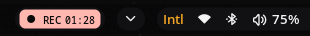

# RecBar

Noctalia v5 bar widget (`nandomoreirame/recbar`) that shows a red **REC** or
**GIF** pill with the elapsed time while `gsr-toggle` (from `~/.dotfiles`) is
recording. It is hidden otherwise. Clicking the pill stops the recording.



## How it works

`gsr-toggle` writes `$XDG_RUNTIME_DIR/gsr-toggle.state` while recording:

```
<mode> <start epoch> <output file>
```

`mode` is `video` (Ctrl+Alt+1) or `gif` (Ctrl+Alt+5). The widget reads that file
once per second with `noctalia.readFile` (no process spawn) and hides itself when
the file is absent.

## Layout

- `widget.luau`: host I/O (read the state file, render, click runs `gsr-toggle`).
- `lib/present.luau`: pure parsing and bar model, with every pt-BR string.

## Tests

```bash
./run-tests
noctalia plugins lint .
```
